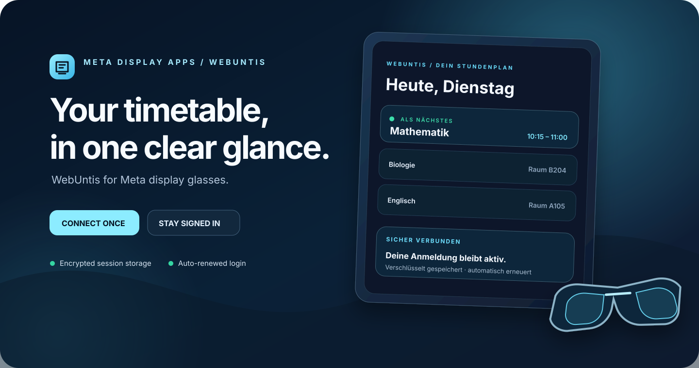

# WebUntis Glasses

**Your school timetable at a glance on Meta display glasses.** Connect once, stay signed in, and keep your next lesson close.

[Open WebUntis Glasses](https://webuntis-glasses.henning-orbit-calendar.workers.dev/) · [English guide](https://webuntis-glasses.henning-orbit-calendar.workers.dev/guide.html) · [Deutsche Anleitung](https://webuntis-glasses.henning-orbit-calendar.workers.dev/guide.de.html)

Part of **Meta Display Apps** · [Orbit Calendar](https://orbit-calendar.henning-orbit-calendar.workers.dev/) · [☕ Buy me a coffee](https://gofund.me/89190630b)

---

## Your school day, ready at a glance

WebUntis Glasses brings your next lesson and daily timetable to supported Meta smart glasses with a display. Pair your glasses once using a short code; your WebUntis session is stored securely and renewed automatically when needed.

### Get started

1. Open the [glasses view](https://webuntis-glasses.henning-orbit-calendar.workers.dev/glasses.html) on your glasses and keep the pairing code visible.
2. Open the [WebUntis web app](https://webuntis-glasses.henning-orbit-calendar.workers.dev/) on your phone or computer. Enter the code and your school’s WebUntis sign-in details.
3. See your next class and daily schedule at a glance. The display refreshes automatically.

Use your regular WebUntis password. The WebUntis Mobile QR key is not a password and is not supported as a sign-in method in this version. The school identifier and server can be changed before pairing.

## Privacy at a glance

- Your WebUntis credentials and session are encrypted before secure storage. The service is hosted on Cloudflare.
- The glasses receive a random device identifier; your password is never sent to them.
- Disconnecting removes your saved profile and pairing.
- WebUntis Glasses only reads your timetable and displays it for you.

The hosted version is intended for personal use. Please review the [privacy information](https://webuntis-glasses.henning-orbit-calendar.workers.dev/guide.html#privacy) before connecting an account.

## Part of Meta Display Apps

Meta Display Apps builds small, glanceable tools for supported Meta display glasses. Visit [Orbit Calendar](https://orbit-calendar.henning-orbit-calendar.workers.dev/), another app in the same family.

Questions or ideas? Read the [WebUntis Glasses guide](https://webuntis-glasses.henning-orbit-calendar.workers.dev/guide.html) or [support the project](https://gofund.me/89190630b).

For source code and developer discussions, visit [GitHub](https://github.com/Henning1908/WebUntis-Glasses).

## License

MIT. See [LICENSE](LICENSE).
